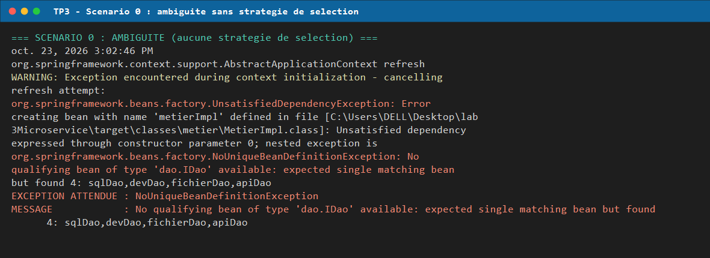
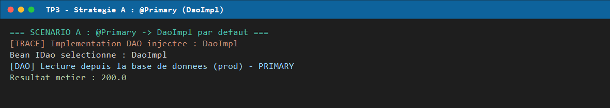
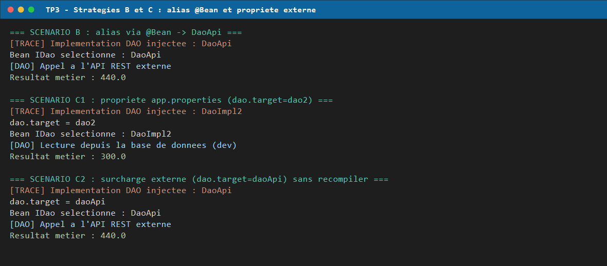
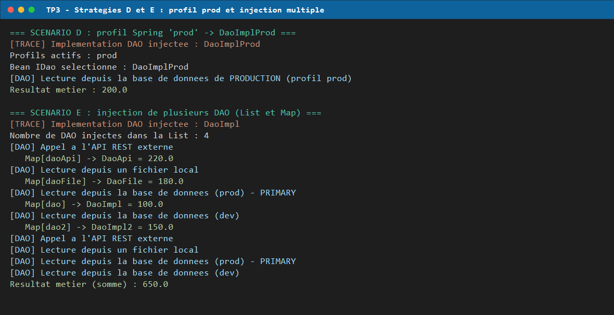
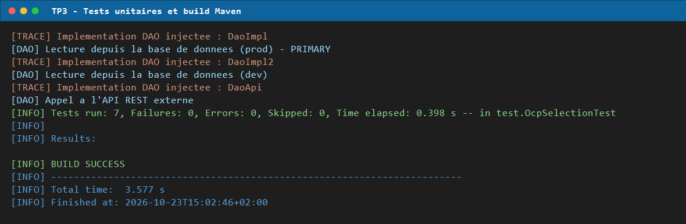

# TP 3 — Spring IoC & OCP : stratégies d'injection et sélection d'implémentations

> **Cours** : Architecture logicielle / Microservices (MLIAEdu) — Lab 155
> **Thème** : principe Open/Closed (OCP), inversion de contrôle (IoC) et sélection
> dynamique d'une implémentation métier **sans modifier le code métier**.

---

## 1. Objectif du TP

Le TP part d'un constat simple : une classe métier qui fait `new DaoImpl()` est
**fermée à l'extension** — chaque changement de source de données oblige à
rouvrir le code métier. L'objectif est de démontrer que l'on peut :

1. inverser la dépendance (le métier dépend de l'interface `IDao`, pas d'une classe) ;
2. **choisir l'implémentation sans toucher à `MetierImpl`**, via cinq mécanismes Spring :
   `@Primary`, alias `@Bean`, propriété externe, profil, injection multiple.

Le critère de réussite du TP est vérifiable : **`MetierImpl.java` n'est jamais
modifié** entre les scénarios, seules les classes de configuration changent.

---

## 2. Prérequis et exécution

| Élément | Version |
|---|---|
| JDK | 17 (testé avec 17.0.18) |
| Maven | 3.9+ |
| Spring Framework | 5.3.30 (`spring-context`) |
| JUnit | 4.13.2 |

```bash
# compilation + tests + exécution des 6 scénarios
mvn clean test exec:java
```

Le point d'entrée est `app.Main` (déclaré dans `exec-maven-plugin`).

---

## 3. Structure du projet

```
lab3-ioc-ocp/
├── pom.xml
├── docs/
│   ├── execution.log                 # sortie réelle de mvn clean test exec:java
│   └── screenshots/
│       ├── 01-ambiguite.png
│       ├── 02-primary.png
│       ├── 03-alias-et-proprietes.png
│       ├── 04-profil-et-multidao.png
│       └── 05-tests-et-build.png
└── src/
    ├── main/
    │   ├── java/
    │   │   ├── dao/
    │   │   │   ├── IDao.java                 # contrat (double getValue())
    │   │   │   ├── DaoImpl.java              # 100.0  @Primary
    │   │   │   ├── DaoImpl2.java             # 150.0
    │   │   │   ├── DaoFile.java              # 180.0
    │   │   │   ├── DaoApi.java               # 220.0
    │   │   │   └── DaoImplProd.java          # 100.0  @Profile("prod")
    │   │   ├── metier/
    │   │   │   ├── IMetier.java
    │   │   │   ├── MetierImpl.java           # NE CHANGE JAMAIS
    │   │   │   └── MetierMultiple.java       # injecte List<IDao> + Map<String,IDao>
    │   │   ├── config/
    │   │   │   ├── AppConfig.java            # stratégie A
    │   │   │   ├── DaoAliasConfig.java       # stratégie B
    │   │   │   ├── DynamicDaoConfig.java     # stratégie C
    │   │   │   ├── AmbiguityDemoConfig.java  # étape 10 : l'ambiguïté
    │   │   │   └── ProdConfig.java           # stratégie D
    │   │   └── app/Main.java                 # les 6 scénarios
    │   └── resources/app.properties
    └── test/java/test/OcpSelectionTest.java  # 7 tests
```

---

## 4. Le contrat et le métier (inchangés)

```java
public interface IDao {
    double getValue();
}

public interface IMetier {
    double calcul();
}

@Service
@Primary
public class MetierImpl implements IMetier {
    private final IDao dao;                       // injection par constructeur

    public MetierImpl(IDao dao) { this.dao = dao; }

    @PostConstruct
    public void init() {
        System.out.println("[TRACE] Implementation DAO injectee : "
                + dao.getClass().getSimpleName());
    }

    @Override
    public double calcul() { return dao.getValue() * 2.0; }
}
```

`MetierImpl` ne connaît **que** `IDao`. Le `@PostConstruct` sert de sonde : il
prouve à l'exécution quelle implémentation Spring a réellement injectée.

---

## 5. Les cinq stratégies de sélection

| # | Stratégie | Mécanisme | Implémentation retenue | `calcul()` |
|---|---|---|---|---|
| 0 | Aucune | 4 `@Bean` sans `@Primary` | *aucune* → `NoUniqueBeanDefinitionException` | — |
| A | `@Primary` | annotation sur `DaoImpl` | `DaoImpl` (100.0) | **200.0** |
| B | Alias `@Bean` | `@Bean @Primary IDao daoAlias()` → `new DaoApi()` | `DaoApi` (220.0) | **440.0** |
| C | Propriété externe | `@Value("${dao.target}")` + `switch` | `dao2` → `DaoImpl2` (150.0) | **300.0** |
| C' | Surcharge à l'exécution | même config, propriété écrasée | `daoApi` → `DaoApi` (220.0) | **440.0** |
| D | Profil Spring | `@Profile("prod")` sur `DaoImplProd` | `DaoImplProd` (100.0) | **200.0** |
| E | Injection multiple | `List<IDao>` + `Map<String,IDao>` | les 4 DAO | **650.0** |

### 5.1 Stratégie 0 — mettre en évidence l'ambiguïté

```java
@Configuration
@ComponentScan(basePackages = "metier")
public class AmbiguityDemoConfig {
    @Bean public IDao sqlDao()     { return new DaoImpl(); }
    @Bean public IDao devDao()     { return new DaoImpl2(); }
    @Bean public IDao fichierDao() { return new DaoFile(); }
    @Bean public IDao apiDao()     { return new DaoApi(); }
}
```

> **Piège important découvert pendant le TP.** Avec des beans nommés `dao`, `dao2`,
> `daoFile`, `daoApi`, Spring **ne lève pas d'exception** : en dernier recours il
> compare le nom du bean au nom du paramètre de constructeur (`dao`) et choisit
> silencieusement `DaoImpl`. L'ambiguïté est donc masquée. Pour la rendre visible,
> les beans sont nommés `sqlDao`, `devDao`, `fichierDao`, `apiDao` — aucun ne
> correspond au paramètre `dao`.

Spring enveloppe de plus l'erreur dans une `UnsatisfiedDependencyException`, la
`NoUniqueBeanDefinitionException` se trouve donc dans la chaîne de causes :

```
org.springframework.beans.factory.UnsatisfiedDependencyException:
  Error creating bean with name 'metierImpl' ... expressed through constructor parameter 0;
  nested exception is
org.springframework.beans.factory.NoUniqueBeanDefinitionException:
  No qualifying bean of type 'dao.IDao' available:
  expected single matching bean but found 4: sqlDao,devDao,fichierDao,apiDao
```



### 5.2 Stratégie A — `@Primary`

```java
@Primary
@Component("dao")
public class DaoImpl implements IDao { /* 100.0 */ }
```



### 5.3 Stratégies B et C — alias `@Bean` et propriété externe

```java
// B : le paquet dao n'est volontairement pas scanné
@Configuration
@ComponentScan("metier")
public class DaoAliasConfig {
    @Bean @Primary
    public IDao daoAlias() { return new DaoApi(); }
}

// C : choix piloté par app.properties (dao.target=dao2)
@Value("${dao.target}") private String daoTarget;

@Bean @Primary
public IDao daoDynamique() {
    switch (daoTarget) {
        case "dao":     return new DaoImpl();
        case "dao2":    return new DaoImpl2();
        case "daoFile": return new DaoFile();
        case "daoApi":  return new DaoApi();
        default: throw new IllegalArgumentException("Cible DAO inconnue : " + daoTarget);
    }
}
```

La surcharge C' ne recompile rien : on ajoute simplement une `MapPropertySource`
en tête de la liste des propriétés (priorité la plus haute, comme une variable
d'environnement).



### 5.4 Stratégie D — profil Spring

```java
@Configuration
@Profile("prod")
@ComponentScan(basePackages = {"dao", "metier"},
    excludeFilters = @ComponentScan.Filter(
        type = FilterType.ASSIGNABLE_TYPE,
        classes = {DaoImpl.class, DaoImpl2.class, DaoFile.class, DaoApi.class}))
public class ProdConfig { }
```

Les quatre DAO "classiques" sont exclus du scan, sinon `DaoImpl` (qui porte
`@Primary`) gagnerait face à `DaoImplProd`.

### 5.5 Stratégie E — injecter *tous* les DAO

```java
@Service("metierMultiple")
public class MetierMultiple implements IMetier {
    private final List<IDao> daos;
    private final Map<String, IDao> daoMap;

    public MetierMultiple(List<IDao> daos, Map<String, IDao> daoMap) { ... }

    @Override
    public double calcul() {
        return daos.stream().mapToDouble(IDao::getValue).sum();
    }
}
```

Spring injecte la liste des candidats et une map `nomDuBean → instance`, sans
`@Primary` ni `@Qualifier`. Somme : 100 + 150 + 180 + 220 = **650.0**.



---

## 6. Résultat réel d'exécution

Sortie obtenue avec `mvn clean test exec:java` (log complet : [`docs/execution.log`](docs/execution.log)) :

```
=== SCENARIO 0 : AMBIGUITE (aucune strategie de selection) ===
EXCEPTION ATTENDUE : NoUniqueBeanDefinitionException
MESSAGE            : No qualifying bean of type 'dao.IDao' available:
                     expected single matching bean but found 4: sqlDao,devDao,fichierDao,apiDao

=== SCENARIO A : @Primary -> DaoImpl par defaut ===
[TRACE] Implementation DAO injectee : DaoImpl
Bean IDao selectionne : DaoImpl
Resultat metier : 200.0

=== SCENARIO B : alias via @Bean -> DaoApi ===
[TRACE] Implementation DAO injectee : DaoApi
Bean IDao selectionne : DaoApi
Resultat metier : 440.0

=== SCENARIO C1 : propriete app.properties (dao.target=dao2) ===
[TRACE] Implementation DAO injectee : DaoImpl2
dao.target = dao2
Resultat metier : 300.0

=== SCENARIO C2 : surcharge externe (dao.target=daoApi) sans recompiler ===
[TRACE] Implementation DAO injectee : DaoApi
dao.target = daoApi
Resultat metier : 440.0

=== SCENARIO D : profil Spring 'prod' -> DaoImplProd ===
[TRACE] Implementation DAO injectee : DaoImplProd
Profils actifs : prod
Resultat metier : 200.0

=== SCENARIO E : injection de plusieurs DAO (List et Map) ===
Nombre de DAO injectes dans la List : 4
   Map[daoApi]  -> DaoApi  = 220.0
   Map[daoFile] -> DaoFile = 180.0
   Map[dao]     -> DaoImpl = 100.0
   Map[dao2]    -> DaoImpl2 = 150.0
Resultat metier (somme) : 650.0

=== FIN ===
```

Toutes les valeurs correspondent à celles calculées dans le tableau de la
section 5 : `MetierImpl` n'a pas été modifiée une seule fois.

---

## 7. Tests unitaires

`src/test/java/test/OcpSelectionTest.java` — 7 tests JUnit 4 :

| Test | Vérifie |
|---|---|
| `testDaoImplParDefaut` | `@Primary` → `DaoImpl` → `200.0` |
| `testAliasPointeVersDaoApi` | alias `@Bean` → `DaoApi` → `440.0` |
| `testProprieteSelectionneDao2` | `app.properties` → `DaoImpl2` → `300.0` |
| `testSurchargeParProprieteExterne` | surcharge → `DaoApi` → `440.0` |
| `testProfilProd` | bean de type `DaoImplProd` + `200.0` |
| `testAmbiguiteSansSelection` | `NoUniqueBeanDefinitionException` avec 4 candidats |
| `testInjectionDePlusieursDao` | 4 DAO dans `List` et `Map`, somme `650.0` |

```
[INFO] Tests run: 7, Failures: 0, Errors: 0, Skipped: 0
[INFO] BUILD SUCCESS
```



---

## 8. Écarts par rapport à l'énoncé (et pourquoi)

| Point | Énoncé | Réalisation | Raison |
|---|---|---|---|
| `@PostConstruct` | `javax.annotation.PostConstruct` | dépendance `javax.annotation-api:1.3.2` ajoutée | retiré du JDK depuis Java 11 |
| Démo d'ambiguïté | beans nommés `dao`, `dao2`… | beans `sqlDao`, `devDao`, `fichierDao`, `apiDao` | sinon Spring résout par nom de paramètre et n'échoue pas |
| `@Primary` sur `MetierImpl` | non demandé | ajouté | `MetierMultiple` implémente aussi `IMetier` ; sans cela `getBean(IMetier.class)` est ambigu |
| `DaoAliasConfig` / `DynamicDaoConfig` | — | ne scannent pas le paquet `dao` | éviter deux beans `@Primary` (interdit par Spring) |
| `ProdConfig` | — | `excludeFilters` sur les 4 DAO | `DaoImpl` `@Primary` gagnerait sinon sur `DaoImplProd` |
| Test d'ambiguïté | `@Test(expected = …)` | recherche dans la chaîne de causes | Spring enveloppe l'exception dans `UnsatisfiedDependencyException` |

---

## 9. Ce que démontre ce TP

1. **OCP** : ajouter une source de données ne demande aucune modification de
   `MetierImpl` — uniquement une nouvelle classe `IDao` et une ligne de configuration.
2. **IoC** : le métier ne construit plus ses dépendances, il les reçoit.
3. **Cinq leviers de sélection** avec des usages complémentaires :
   - `@Primary` → défaut d'application ;
   - alias `@Bean` → choix d'infrastructure figé dans une configuration ;
   - propriété externe → **le même artefact se comporte différemment selon l'environnement** ;
   - profil → séparation strictement dev / prod ;
   - `List` / `Map` → patterns de type *strategy aggregator* (routeur multi-sources).
4. **Une erreur d'ambiguïté est un symptôme de conception**, pas un bug Spring :
   elle apparaît quand deux implémentations sont candidates sans critère de choix.

---

## 10. Auteur

**Yasmine Ait Halibi** — TP 3, Spring IoC & OCP.
